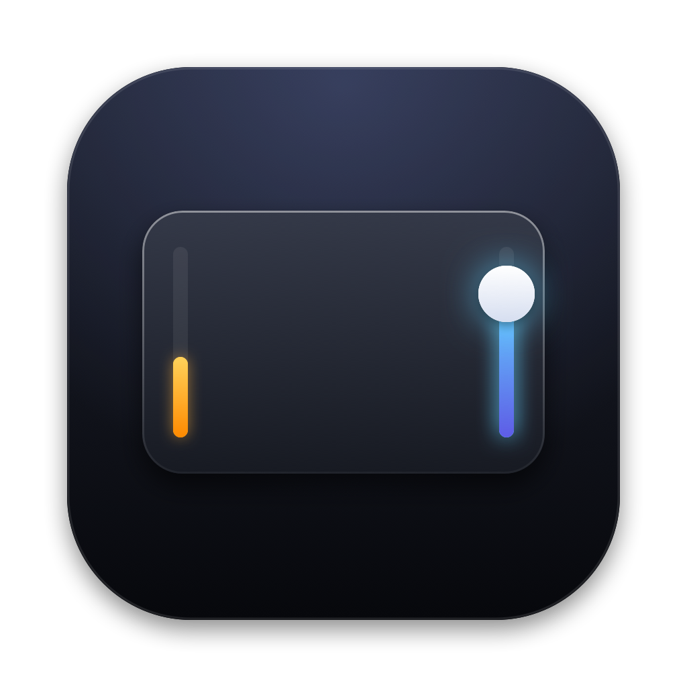

<p align="center"></p>

# TrackEdge

TrackEdge turns the edges of your MacBook trackpad into volume and brightness sliders.
Slide a finger along the right edge to change volume, or along the left edge to change brightness.
macOS shows its own volume and brightness display, the same one the keyboard keys show.

TrackEdge is a free, open-source menu bar app for macOS 13 and later.
It was inspired by [EdgeBar](https://edgebar.xyz) and is not affiliated with it.

## Gestures

| Where | Gesture | What happens |
| --- | --- | --- |
| Right edge | Slide up or down | Volume |
| Left edge | Slide up or down | Brightness |
| Top-right corner | Double-tap | Mute or unmute |
| Bottom edge | Swipe left or right | Previous or next track |
| Bottom edge | Double-tap | Play or pause |

Every gesture uses one finger.
A second finger cancels the gesture, so normal scrolling and multi-finger gestures keep working.
Each step gives a light haptic tick under your finger on Force Touch trackpads.

## Settings

The menu bar popover holds the everyday controls:

- Sensitivity sets how far you slide for each step.
- Edge width sets how wide the slide zones are.
- Haptics sets the tick strength: off, light, medium, or strong.
- Media strip, Quick mute, and Precise sliding switch those features on or off.

The settings window holds the one-time choices:

- Swap sides puts brightness on the right edge.
- Bottom quarter only makes edges respond only to slides that start low on the trackpad.
- Require Fn or Option makes edges respond only while you hold one of those keys.
- Fine control with Shift-Option gives quarter steps while you hold both keys.
- Freeze cursor keeps the pointer still and hidden while you slide.
- Reverse swipe flips the media strip direction.
- Magic Mouse support uses the top part of the mouse's side edges.
- Appearance and Open at login do what they say.

## Install

Build from source with Xcode 15 or later:

```bash
git clone https://github.com/apurv-1/trackedge.git
cd trackedge
make run
```

On first launch, macOS asks you to give TrackEdge Accessibility access in System Settings > Privacy & Security > Accessibility.
TrackEdge needs that access to post media key events and to freeze the cursor.
It makes no network connections.

## How it works

TrackEdge reads raw finger positions from Apple's private MultitouchSupport framework.
A small gesture engine in `Sources/TrackEdgeCore` turns those positions into actions, and it has unit tests for every gesture rule.
For each action, TrackEdge posts the same media key event that the hardware keys send.
macOS then changes the value and draws its own display, and Shift-Option on that event gives the system's quarter steps.

TrackEdge restarts touch input when a trackpad or Magic Mouse connects or disconnects, and when the Mac wakes from sleep.

## Limits

- MultitouchSupport is a private framework, so a future macOS update could break touch input.
  TrackEdge loads it at runtime and shows a notice instead of crashing if it is missing.
- Brightness keys control the built-in display.
  External displays follow whatever macOS does for the brightness keys.
- Tap to click still clicks when you tap an edge, because macOS handles clicks before TrackEdge sees them.

## Contributing

See [CONTRIBUTING.md](CONTRIBUTING.md).
Security reports go through [SECURITY.md](SECURITY.md).

## License

[MIT](LICENSE)
